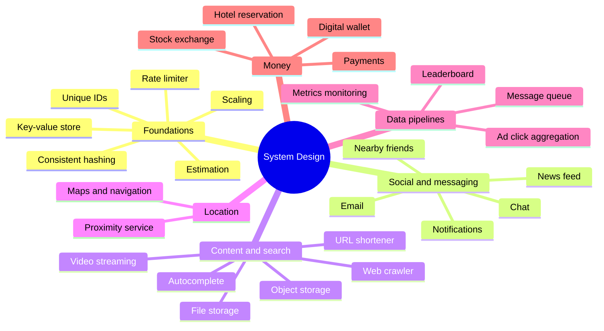

# 🏗️ System Design Interview Questions

**28 classic system design problems, each written as a 45-minute interview answer.**

Requirements · Estimates · Architecture diagrams · Deep dives · Trade-offs · Practice questions

---

## 📌 Start here

1. Read the **[interview framework](notes/03-interview-framework.md)**: it's the script every answer follows.
2. Skim the **[building blocks cheat sheet](notes/00-building-blocks.md)** and the **[estimation guide](notes/02-estimation.md)**.
3. Work through the problems with the [4-week plan](#-4-week-study-plan) below.

## 🗺️ Topic map

## 📚 All notes

**Difficulty:** 🟢 Easy · 🟡 Medium · 🔴 Hard

### Foundations

| # | Topic | Level | Key ideas |
|:-:|-------|:-----:|-----------|
| 00 | [Building blocks cheat sheet](notes/00-building-blocks.md) | — | When to use each component |
| 01 | [Scaling from one server to millions](notes/01-scaling.md) | 🟢 | Stateless tiers, caching, replication, sharding |
| 02 | [Back-of-the-envelope estimation](notes/02-estimation.md) | 🟢 | Powers of two, latency numbers, QPS math |
| 03 | [Interview framework](notes/03-interview-framework.md) | 🟢 | How to run the 45 minutes |
| 04 | [Rate limiter](notes/04-rate-limiter.md) | 🟢 | Token bucket, sliding window, Redis |
| 05 | [Consistent hashing](notes/05-consistent-hashing.md) | 🟢 | Hash ring, virtual nodes |
| 06 | [Key-value store](notes/06-key-value-store.md) | 🟡 | Quorums, vector clocks, gossip, LSM trees |
| 07 | [Unique ID generator](notes/07-unique-id-generator.md) | 🟢 | Snowflake-style 64-bit IDs |

### Classic product designs

| # | Topic | Level | Key ideas |
|:-:|-------|:-----:|-----------|
| 08 | [URL shortener](notes/08-url-shortener.md) | 🟢 | Base62, redirect caching |
| 09 | [Web crawler](notes/09-web-crawler.md) | 🟡 | URL frontier, politeness, dedup |
| 10 | [Notification system](notes/10-notification-system.md) | 🟢 | Per-channel queues, retries |
| 11 | [News feed](notes/11-news-feed.md) | 🟡 | Fan-out on write vs read |
| 12 | [Chat system](notes/12-chat-system.md) | 🟡 | WebSockets, presence, sync |
| 13 | [Search autocomplete](notes/13-search-autocomplete.md) | 🟡 | Trie with cached top-k |
| 14 | [Video streaming](notes/14-video-streaming.md) | 🔴 | Transcoding DAG, adaptive bitrate, CDN |
| 15 | [Cloud file storage](notes/15-cloud-file-storage.md) | 🔴 | Block-level delta sync, dedup |

### Location, data and infrastructure

| # | Topic | Level | Key ideas |
|:-:|-------|:-----:|-----------|
| 16 | [Proximity service](notes/16-proximity-service.md) | 🟡 | Geohash, quadtree |
| 17 | [Nearby friends](notes/17-nearby-friends.md) | 🔴 | Pub/sub location fan-out |
| 18 | [Maps and navigation](notes/18-maps-navigation.md) | 🔴 | Tiles, routing graph, ETA |
| 19 | [Distributed message queue](notes/19-message-queue.md) | 🔴 | Partitioned logs, ISR, consumer groups |
| 20 | [Metrics monitoring and alerting](notes/20-metrics-monitoring.md) | 🟡 | Time-series DB, downsampling |
| 21 | [Ad click aggregation](notes/21-ad-click-aggregation.md) | 🔴 | Stream windows, exactly-once |
| 22 | [Hotel reservation](notes/22-hotel-reservation.md) | 🟡 | Inventory, optimistic locking |
| 23 | [Email service](notes/23-email-service.md) | 🔴 | SMTP, per-user storage and search |
| 24 | [Object storage](notes/24-object-storage.md) | 🔴 | Metadata/data split, erasure coding |
| 25 | [Real-time leaderboard](notes/25-leaderboard.md) | 🟢 | Redis sorted sets |
| 26 | [Payment system](notes/26-payment-system.md) | 🔴 | Idempotency, ledger, reconciliation |
| 27 | [Digital wallet](notes/27-digital-wallet.md) | 🔴 | Event sourcing, TC/C, Raft |
| 28 | [Stock exchange](notes/28-stock-exchange.md) | 🔴 | Order book, matching engine |

## 🧩 How each note is laid out

| Section | What it gives you |
|---------|-------------------|
| 💡 **30-second answer** | The core design in three lines, for quick review |
| **Requirements** | What to clarify in the first 5 minutes |
| **Estimates** | The numbers that drive the design |
| **Design** | Architecture diagram and the main flows |
| **Deep dives** | What interviewers usually dig into |
| ❌ **Common mistakes** | What loses points |
| **Practice questions** | Follow-ups to answer out loud |

## 📅 4-week study plan

| Week | Focus | Notes |
|------|-------|-------|
| 1 | Foundations | 00–07 |
| 2 | Everyday products | 08, 10, 11, 12, 13, 25 |
| 3 | Heavier systems | 09, 14, 15, 16, 17, 19, 20 |
| 4 | Correctness and money | 21, 22, 24, 26, 27, 28 (+ 18, 23 if time) |

**Daily routine (~1 hour)**

1. Read only the problem title and design it on paper in 35 minutes.
2. Open the note and compare: requirements, numbers, components, trade-offs.
3. Check yourself against the **common mistakes**.
4. Answer two practice questions out loud, as if to an interviewer.

## 🔁 Patterns that show up everywhere

| Pattern | Seen in |
|---------|---------|
| Cache-aside + CDN | URL shortener, news feed, video, proximity |
| Queue between producer and slow work | Notifications, video transcoding, crawler, email |
| Consistent hashing / sharding | KV store, chat, nearby friends, leaderboard |
| Idempotency keys | Payments, hotel reservation, notifications |
| Append-only log + replay | Message queue, digital wallet, stock exchange, ad clicks |
| Fan-out on write vs read | News feed, nearby friends, chat groups |
| Geospatial indexing | Proximity service, nearby friends, maps |
