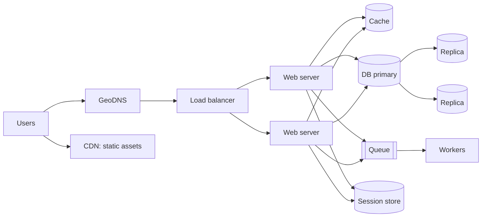

# 01 · Scaling From One Server to Millions of Users

**Difficulty:** 🟢 Easy &nbsp;|&nbsp; **Topics:** load-balancing · caching · replication · sharding

> [!TIP]
> **30-second answer**
> - Make the web tier stateless and put it behind a load balancer.
> - Use primary/replica DBs, then a cache and a CDN to take reads off the database.
> - Shard the database once writes outgrow one primary; use queues for slow work.

<b>Contents</b>

- [Step-by-step evolution](#step-by-step-evolution)
- [Target architecture](#target-architecture)
- [Caching notes](#caching-notes)
- [Sharding notes](#sharding-notes)
- [Common mistakes](#common-mistakes)
- [Practice questions](#practice-questions)

The story of how a simple app grows. Each step removes the current bottleneck.

## Step-by-step evolution

1. **Single box** – web app and database on one machine. Fine for a prototype.
2. **Split web and DB** – scale each tier independently.
3. **Vertical scaling** – a bigger machine. Easy, but has a hard ceiling and no failover.
4. **Horizontal web tier + load balancer** – many identical app servers behind an LB.
5. **Database replication** – one primary for writes, replicas for reads. Promote a replica on failure.
6. **Cache** – keep hot reads in memory to cut DB load and latency.
7. **CDN** – serve static files from edge locations near users.
8. **Stateless servers** – move sessions to a shared store (Redis, DB) so any server can handle any request.
9. **Multiple data centers** – geo-routing (GeoDNS), data replicated across regions.
10. **Message queues** – push slow work (emails, thumbnails) to background workers.
11. **Logging, metrics, automation** – you can't scale what you can't see.
12. **Sharding** – split the database by a shard key once one primary can't take the writes.

## Target architecture

## Caching notes

- **Cache-aside** is the default: read cache → on miss read DB → populate cache.
- Set a **TTL** that matches how stale the data is allowed to be.
- Plan for **eviction** (LRU is typical) and **cold starts**.
- Avoid one giant cache node: shard it, and replicate the hot keys.

## Sharding notes

- Choose a key with **high cardinality and even access** (user_id usually works; country usually doesn't).
- Problems to mention: **hot shards** (celebrity users), **resharding**, and **cross-shard joins**, which usually means denormalizing.
- Consistent hashing (see [05](05-consistent-hashing.md)) makes resharding cheaper.

## Common mistakes

- ❌ Sharding before trying replicas and caching first.
- ❌ Keeping sessions on the web server, which breaks horizontal scaling.
- ❌ Forgetting replication lag and read-your-writes consistency.

## Practice questions

- When would you pick vertical scaling over horizontal?
- How do you keep a session alive when the server that created it dies?
- A replica lags 5 seconds behind. A user updates their profile and refreshes. What do they see, and how do you fix it?
- What breaks first if traffic grows 10× overnight?

---

[← Building Blocks](00-building-blocks.md) &nbsp;·&nbsp; [🏠 All notes](../README.md) &nbsp;·&nbsp; [Estimation →](02-estimation.md)
