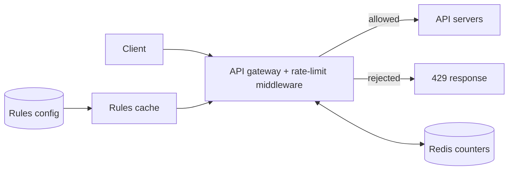

# 04 · Rate Limiter

Limit how many requests a client can send in a time window to protect services from abuse, runaway clients, and cost overruns.

## Requirements

- Limit by user ID, API key, IP, or endpoint, with configurable rules.
- Low latency: must not slow the request path noticeably.
- Works across many API servers (distributed).
- Clear feedback: HTTP **429 Too Many Requests** plus headers.
- Fail open: if the limiter is down, don't take the API down with it.

## Where to put it

- **API gateway / middleware** (most common), in front of services.
- In the service itself, for fine-grained business limits.
- Client-side limits are only a courtesy, since clients can't be trusted.

## Algorithms

| Algorithm | How it works | Pros | Cons |
|-----------|--------------|------|------|
| Token bucket | Bucket refills at rate r, holds up to b tokens; each request takes one | Allows bursts, memory-light | Two params to tune |
| Leaking bucket | Requests enter a FIFO queue processed at a fixed rate | Smooth output rate | Bursts fill the queue; old requests starve new ones |
| Fixed window counter | Count per window (e.g. per minute) | Very simple | Traffic spike at window edges can allow 2× the limit |
| Sliding window log | Keep timestamps of each request; count those within window | Exact | Memory-heavy |
| Sliding window counter | Weighted mix of current and previous window counts | Good approximation, cheap | Approximate |

Default choice: **token bucket** (used widely by cloud APIs) or **sliding window counter**.

## Design

1. Request arrives; middleware builds a key, for example `rl:{user_id}:{endpoint}`.
2. Atomically read and update the counter in Redis (`INCR` + `EXPIRE`, or a Lua script for token bucket).
3. If under the limit → forward; else → return 429.

Response headers:
- `X-RateLimit-Limit`, `X-RateLimit-Remaining`, `Retry-After`

## Distributed challenges

- **Race conditions**: two servers read the same count and both allow. Fix with atomic Lua scripts or Redis `INCR`.
- **Synchronization across regions**: use a central Redis per region, and accept slight over-allowance across regions.
- **Hot keys**: shard Redis by key; keep rules cached locally.
- **Failure mode**: if Redis is unreachable, fail open (allow) with a local in-memory fallback limit.

## Extras worth mentioning

- Soft vs hard limits; queueing excess requests instead of dropping them.
- Rate limiting at other layers (L3/L4 with iptables, or at the CDN/WAF).
- Monitor reject rates to tune rules.

## Practice questions

- Show how a fixed window allows 2× traffic at the boundary.
- How would you implement token bucket in Redis atomically?
- Different limits for free vs paid tiers: where do rules live and how are they updated?
- How do you rate-limit across 3 regions without a global lock?
