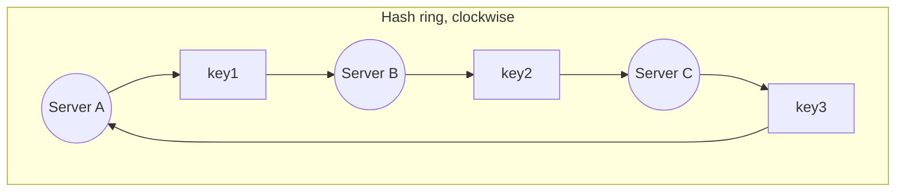

# 05 · Consistent Hashing

How to spread keys over servers so that adding or removing a server only moves a small fraction of keys.

## The problem with `hash(key) % N`

If N changes from 4 to 5, almost every key maps to a different server. For a cache that means a mass of misses all at once; for storage it means moving almost all the data.

## The hash ring

- Map the hash space (e.g. 0 … 2^32−1) onto a circle.
- Hash each **server** onto the ring.
- Hash each **key** onto the ring and walk **clockwise** to the first server: that server owns the key.

*key1 → Server B, key2 → Server C, key3 → Server A*

- **Add a server**: only keys between the new server and its predecessor move.
- **Remove a server**: only its keys move to the next server clockwise.
- On average only **k/N** keys move (k = keys, N = servers).

## Virtual nodes

With few servers, ring segments are uneven and one server gets far more keys.

- Put each physical server on the ring many times (e.g. 100–200 **virtual nodes**).
- More virtual nodes → more even distribution (lower standard deviation).
- Lets you give bigger machines more virtual nodes (weighting).
- Cost: more metadata to store and look up.

## Replication on the ring

To keep N copies, store the key on the first N **distinct physical** servers clockwise (skip virtual nodes of the same machine). Used by Dynamo-style stores; see [06](06-key-value-store.md).

## Where it's used

- Partitioning in Cassandra, DynamoDB-style stores
- Distributed caches and client-side sharding of Memcached
- Load balancers with session affinity
- CDNs choosing which edge server caches an object

## Practice questions

- Why does modulo hashing fail when nodes change?
- How do virtual nodes fix skew? What do they cost?
- How would you handle a single hot key that overloads its server?
- Compare consistent hashing with rendezvous (highest-random-weight) hashing.
