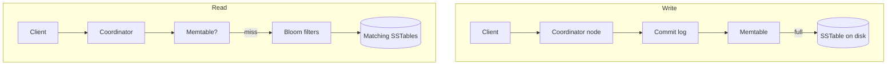

# 06 · Distributed Key-Value Store

Design `put(key, value)` / `get(key)` that scales horizontally and stays available. Think Dynamo, Cassandra, Riak.

## Requirements

- Small values (< 10 KB), huge number of keys.
- High availability and low latency, even during failures.
- Tunable consistency.
- Automatic scaling as nodes are added.

## CAP choice

During a partition you pick one:
- **CP** – refuse writes/reads that can't reach a quorum (e.g. banking).
- **AP** – keep serving and reconcile later (e.g. shopping carts, sessions).

Most Dynamo-style stores are **AP with tunable consistency**.

## Core techniques

| Concern | Technique |
|---------|-----------|
| Partitioning | Consistent hashing with virtual nodes |
| Replication | Copy to the next N distinct nodes on the ring, across racks/regions |
| Consistency | Quorums: N replicas, W write acks, R read acks |
| Versioning / conflicts | Vector clocks (or last-write-wins timestamps) |
| Failure detection | Gossip protocol with heartbeats |
| Temporary failures | Sloppy quorum + hinted handoff |
| Permanent failures | Anti-entropy using Merkle trees |
| Storage engine | Commit log + memtable + SSTables (LSM tree), Bloom filters |

## Quorum math

- **W + R > N** → reads overlap with the latest write (strong-ish consistency).
- N=3, W=2, R=2 is a common balanced setting.
- W=1 → fast writes; R=1 → fast reads; both = 1 → eventual consistency.

## Write and read paths

## Conflict resolution with vector clocks

- Each value carries `[(node, counter), …]`.
- If one clock is ≥ the other in every entry, it's a newer version: discard the older.
- Otherwise they **conflict**; return both to the client (or apply a merge rule).
- Trim old entries to keep clocks small.

## Handling failures

- **Gossip**: each node periodically shares a heartbeat table with random peers; a node is marked down when many peers agree.
- **Hinted handoff**: if a replica is down, another node accepts the write with a "hint" and replays it later.
- **Merkle trees**: compare hash trees of key ranges between replicas and sync only differing buckets.
- **Multi-datacenter replication** for disaster recovery.

## Practice questions

- Pick N, W, R for a read-heavy, latency-sensitive workload. Justify.
- Walk through a conflict with vector clocks and how the client resolves it.
- Why use an LSM tree instead of a B-tree here?
- How do you add a node without downtime?
