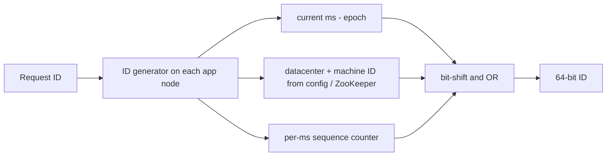

# 07 · Unique ID Generator in Distributed Systems

Generate unique IDs across many machines at high throughput, without one central bottleneck.

## Requirements

- Globally unique, numeric, fits in **64 bits**.
- Roughly **sortable by time**.
- 10,000+ IDs per second per node; very low latency.
- No single point of failure.

## Options

| Approach | How | Pros | Cons |
|----------|-----|------|------|
| DB auto-increment with step | k servers, each increments by k | Simple, numeric | Hard to add servers, not time-ordered across servers |
| UUID v4 | 128-bit random | No coordination | 128 bits, not sortable, poor index locality |
| Ticket server | One DB hands out IDs (e.g. `REPLACE INTO`) | Numeric, simple | Single point of failure or sync issues if doubled |
| Snowflake-style | Timestamp + machine + sequence bits | Sortable, 64-bit, local generation | Needs clock discipline |

## Snowflake layout (64 bits)

```
| 1 sign | 41 timestamp (ms) | 5 datacenter | 5 machine | 12 sequence |
```

- **41 bits of ms** since a custom epoch ≈ 69 years.
- **10 bits** → 1,024 machines.
- **12 bits sequence** → 4,096 IDs per ms per machine (~4M/s).



## Edge cases to discuss

- **Sequence overflow** inside one ms: wait for the next ms.
- **Clock moving backwards** (NTP adjustment): refuse to generate until the clock catches up, or use the last timestamp seen.
- **Assigning machine IDs**: static config, or lease from ZooKeeper/etcd at startup.
- Tune the bit split: fewer machine bits and more sequence bits for low-concurrency, high-throughput setups.

## Practice questions

- Why are UUIDs bad as primary keys in a B-tree index?
- What happens if two nodes accidentally get the same machine ID?
- How long until the 41-bit timestamp runs out, and how would you migrate?
- How would you make IDs non-guessable while still sortable?
