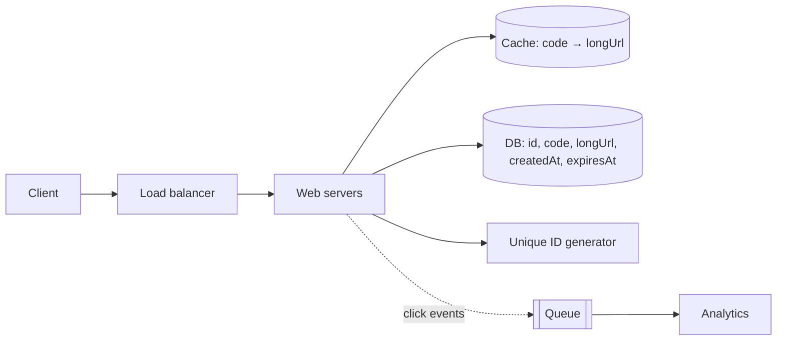

# 08 · URL Shortener

Turn `https://example.com/some/very/long/path?x=1` into `https://sho.rt/aZ3kQ9b` and redirect back.

## Requirements

- Shorten a long URL; redirect a short URL to the original.
- Optional: custom aliases, expiry, click analytics.
- Very read-heavy (~10:1 or more), low-latency redirects, highly available.

## Estimates

- 100M new URLs/day → ~1,200 writes/s; ~12,000 redirects/s.
- 10 years × 365 × 100M ≈ **365B URLs**.
- Base62 length 7 → 62^7 ≈ **3.5 trillion** combinations: enough.
- ~100 bytes per record → ~36 TB over 10 years.

## API

```
POST /api/v1/urls        { "longUrl": "...", "alias"?: "...", "expiresAt"?: "..." }  → { "shortUrl": "..." }
GET  /{code}             → 301 or 302 with Location: longUrl
```

**301 vs 302**: 301 (permanent) is cached by browsers, so it's cheaper for the server, but you lose click tracking. 302 (temporary) means every click hits you, which is good for analytics.

## Design



## Generating the short code

| Approach | How | Trade-off |
|----------|-----|-----------|
| Hash + truncate | MD5/SHA of long URL, take first 7 chars; on collision, append salt and retry | Needs a DB lookup to check collisions; Bloom filter helps |
| Unique ID + Base62 | Get a 64-bit ID ([07](07-unique-id-generator.md)), encode in Base62 | No collisions, but codes are guessable/sequential |
| Pre-generated key pool | Offline service generates random codes; servers grab batches | Fast and random; must manage the pool |

Base62 alphabet: `0-9a-zA-Z`.

## Redirect flow

1. Look up the code in the cache → hit → redirect.
2. Miss → read the DB → populate the cache → redirect.
3. Not found or expired → 404.

## Deep-dive topics

- **Dedup**: same long URL → same code? Only if you index `longUrl` (costly); often not required.
- **Hot links**: CDN/edge caching of redirects.
- **Abuse**: rate limiting, malware URL scanning.
- **Analytics** asynchronously, so redirects stay fast.
- **Expiry cleanup**: lazy deletion on read plus a periodic batch job.

## Practice questions

- Why Base62 and length 7?
- How do you avoid collisions with the hash approach at scale?
- How would you support 1M redirects/s globally?
- How do you prevent people from enumerating all short URLs?
