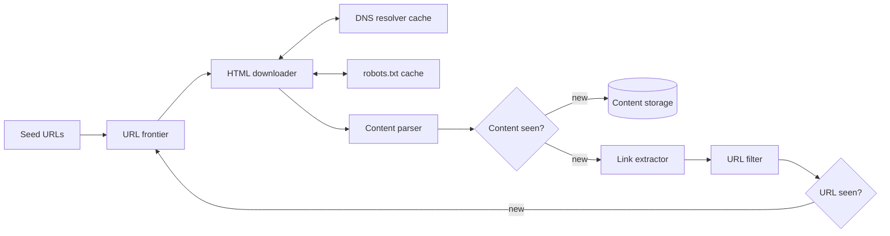

# 09 · Web Crawler

**Difficulty:** 🟡 Medium &nbsp;|&nbsp; **Topics:** URL frontier · politeness · dedup

> [!TIP]
> **30-second answer**
> - BFS through a URL frontier with priority queues and one back queue per host for politeness.
> - Dedup URLs (Bloom filter) and content (hash/SimHash); respect robots.txt; guard against traps.

<b>Contents</b>

- [Requirements](#requirements)
- [Estimates](#estimates)
- [Pipeline](#pipeline)
- [URL frontier (the heart of the crawler)](#url-frontier-the-heart-of-the-crawler)
- [Deduplication](#deduplication)
- [Robustness and traps](#robustness-and-traps)
- [Freshness](#freshness)
- [Common mistakes](#common-mistakes)
- [Practice questions](#practice-questions)

Download web pages at scale for search indexing, archiving, or data mining.

## Requirements

- Crawl ~1B pages/month, HTML only to start.
- **Polite**: don't overload any single site; obey `robots.txt`.
- **Robust**: survive bad HTML, traps, slow servers.
- Skip duplicate content; re-crawl pages that change.

## Estimates

- 1B pages / 30 days ≈ **~400 pages/s**, peak ~800.
- 500 KB avg page → ~500 TB/month raw; ~30 PB over 5 years.

## Pipeline

## URL frontier (the heart of the crawler)

- **Priority**: front queues ranked by importance (PageRank, freshness, traffic).
- **Politeness**: back queues, **one per host**; a worker thread pulls from one host's queue with a delay between requests.
- A mapping table `host → back queue` routes URLs.
- Large: keep most of it on disk with in-memory buffers at the head and tail.

## Deduplication

- **URL seen**: Bloom filter or hash set of normalized URLs.
- **Content seen**: hash (or SimHash for near-duplicates) of page content; a big fraction of the web is duplicates.

## Robustness and traps

- Timeouts and max page size.
- **Spider traps** (infinite calendars, `/a/a/a/a…`): cap URL length and depth, and per-host page limits.
- Filter out spam, ads, and unwanted file types.
- Consistent hashing to spread work across crawler servers; checkpoint the frontier state for crash recovery.

## Freshness

- Re-crawl based on how often a page historically changes and how important it is.
- Use `Last-Modified` / `ETag` with conditional GETs.

## Common mistakes

- ❌ Crawling with no per-host politeness.
- ❌ No defense against spider traps.
- ❌ Forgetting DNS resolution as a bottleneck.

## Practice questions

- How does the frontier enforce one-request-per-host-per-second across 1,000 workers?
- Bloom filter false positives: what's the impact here?
- How would you crawl JavaScript-heavy pages?
- How do you distribute the crawler geographically?

---

[← URL Shortener](08-url-shortener.md) &nbsp;·&nbsp; [🏠 All notes](../README.md) &nbsp;·&nbsp; [Notification System →](10-notification-system.md)
