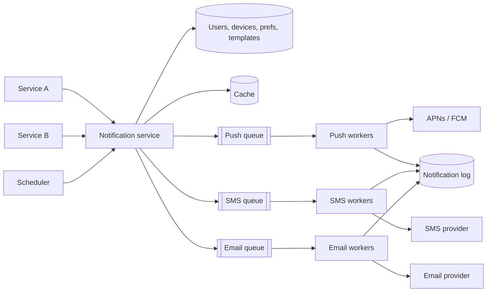

# 10 · Notification System

**Difficulty:** 🟢 Easy &nbsp;|&nbsp; **Topics:** queues · retries · providers

> [!TIP]
> **30-second answer**
> - Notification service checks preferences and templates, then fans out to one queue per channel.
> - Workers call APNs/FCM/SMS/email providers with retries, a dead-letter queue, and dedup IDs.

<b>Contents</b>

- [Requirements](#requirements)
- [Design](#design)
- [Notification service responsibilities](#notification-service-responsibilities)
- [Reliability](#reliability)
- [Other concerns](#other-concerns)
- [Common mistakes](#common-mistakes)
- [Practice questions](#practice-questions)

Send push, SMS, and email notifications reliably at scale.

## Requirements

- Channels: iOS push (APNs), Android push (FCM), SMS, email.
- Triggered by services (order shipped) or scheduled (marketing).
- ~10M push, 1M SMS, 5M emails/day.
- Soft real-time: a small delay is fine; **no lost notifications**.
- Users can opt out per channel; rate limits per user.

## Design

Why a queue per channel: an outage at the SMS provider shouldn't block push or email.

## Notification service responsibilities

1. Authenticate and rate-limit callers.
2. Look up the user's devices, contact info, and **preferences/opt-outs**.
3. Render the **template** with parameters.
4. Enqueue to the right channel queue.

## Reliability

- **Persist** each notification (log table) before sending so it can be retried.
- Workers **retry** with exponential backoff; dead-letter queue after N failures.
- **Exactly-once is not possible** end to end; aim for at-least-once and **dedupe** with a notification ID / event ID.
- Fail over to a secondary provider if one is down.

## Other concerns

- **Rate limiting per user** to avoid spamming.
- **Tracking**: delivered, opened, clicked (via webhooks and tracking pixels/links).
- **Security**: only authenticated internal services can send; appKey/appSecret for third parties.
- **Device tokens** expire or rotate: clean them up on provider feedback.
- **Monitoring** queue depth to scale workers.

## Common mistakes

- ❌ One shared queue so one provider outage blocks all channels.
- ❌ Promising exactly-once delivery.
- ❌ Ignoring opt-outs and per-user rate limits.

## Practice questions

- How do you send a marketing blast to 50M users without overwhelming providers?
- How do you avoid sending the same push twice after a worker crash?
- Where do you enforce a user's quiet hours?
- How do you support a new channel (WhatsApp) with minimal changes?

---

[← Web Crawler](09-web-crawler.md) &nbsp;·&nbsp; [🏠 All notes](../README.md) &nbsp;·&nbsp; [News Feed →](11-news-feed.md)
