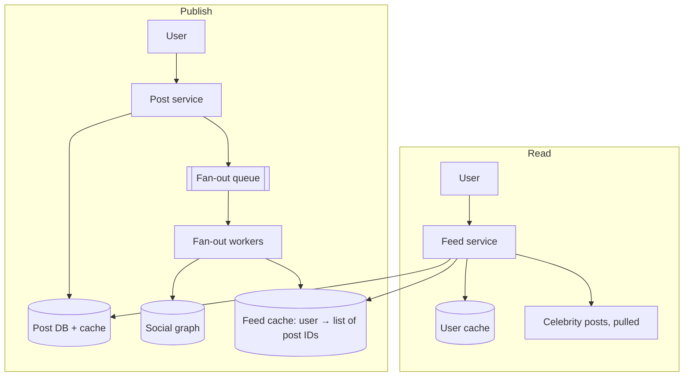

# 11 · News Feed System

**Difficulty:** 🟡 Medium &nbsp;|&nbsp; **Topics:** fan-out · cache · ranking

> [!TIP]
> **30-second answer**
> - Hybrid fan-out: push post IDs to followers' feed caches, pull for celebrities at read time.
> - Feed cache stores only IDs; hydrate from post and user caches.

<b>Contents</b>

- [Requirements](#requirements)
- [Two flows](#two-flows)
- [Fan-out strategies](#fan-out-strategies)
- [Design](#design)
- [Data and caching](#data-and-caching)
- [Deep dives](#deep-dives)
- [Common mistakes](#common-mistakes)
- [Practice questions](#practice-questions)

Users publish posts; each user sees a feed of posts from people they follow.

## Requirements

- Publish a post (text, images).
- Fetch a personalized feed, reverse-chronological (ranking optional).
- 10M DAU, a user follows up to ~5,000 others.
- Feed loads fast (< 200 ms); a few seconds of delay for new posts is OK.

## Two flows

1. **Publish**: store post → fan it out to followers' feeds.
2. **Read**: fetch the feed list → hydrate post and author details.

## Fan-out strategies

| | Fan-out on write (push) | Fan-out on read (pull) |
|---|---|---|
| When | At publish time, insert post ID into each follower's feed cache | At read time, fetch recent posts of everyone you follow |
| Reads | Very fast | Slow, many queries |
| Writes | Expensive for users with millions of followers | Cheap |
| Waste | Pushes to inactive users | None |

**Hybrid** (common answer): push for normal users; **pull for celebrities** and merge at read time. Skip pushing to inactive users.

## Design

## Data and caching

- **Feed cache** stores only `post_id` (+ author_id) per user, capped to the latest ~500–1,000 entries.
- Separate caches: posts (content), users, social graph, counters (likes, comments).
- Media served via CDN.

## Deep dives

- **Pagination**: cursor based on post ID/timestamp, not offset.
- **Ranking**: candidate generation from the feed cache → ML scoring → re-rank.
- **Consistency**: deleted posts must be filtered at read time.
- **Hot users**: a celebrity post read by millions → replicate the post cache.

## Common mistakes

- ❌ Pure fan-out on write with no plan for celebrities.
- ❌ Storing full post content in every feed.
- ❌ Offset-based pagination on a changing feed.

## Practice questions

- Why store only IDs in the feed cache?
- How does the feed of a user who follows 3 celebrities and 400 normal users get built?
- A user unfollows someone: what changes?
- How would you add ads into the feed?

---

[← Notification System](10-notification-system.md) &nbsp;·&nbsp; [🏠 All notes](../README.md) &nbsp;·&nbsp; [Chat System →](12-chat-system.md)
