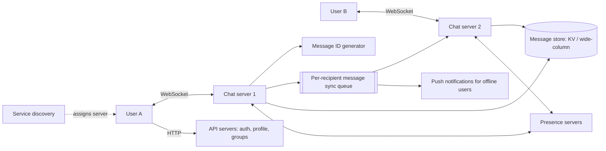

# 12 · Chat System

One-on-one and small group chat with online presence, across mobile and web.

## Requirements

- 1:1 and group chat (up to ~100 members).
- Online/offline presence, multi-device sync, push for offline users.
- 50M DAU, low latency delivery, messages stored permanently.

## Connection protocols

| Option | Notes |
|--------|-------|
| Short polling | Wasteful; most responses are empty |
| Long polling | Better, but servers can't easily push and connections churn |
| **WebSocket** | Bi-directional, persistent; the standard choice for chat |

Use plain HTTP for everything else (login, profile, group management).

## Design

## Message flow (1:1)

1. A sends a message over its WebSocket to chat server 1.
2. Server gets a **message ID** (must be ordered within a conversation).
3. Message is stored in the KV store and put on B's sync queue.
4. If B is online, chat server 2 pushes it over B's socket; otherwise a push notification goes out.

## Storage

- Huge write volume and mostly recent reads → **wide-column / KV store** (HBase, Cassandra).
- 1:1 table key: `(channel_id, message_id)`; group table: `(group_id, message_id)`.
- Message IDs: per-conversation sequence or Snowflake-style IDs ([07](07-unique-id-generator.md)) for ordering.

## Multi-device sync

Each device tracks `cur_max_message_id`; on reconnect it fetches messages with a larger ID.

## Presence

- Mark online on connect; offline when the **heartbeat** stops for ~30 s (tolerates flaky networks).
- Publish status changes over pub/sub channels to friends. For big groups, fetch presence on demand instead.

## Practice questions

- How does service discovery choose a chat server for a user?
- How do you guarantee message order in a group?
- What happens to in-flight messages when a chat server crashes?
- How would you add end-to-end encryption?
