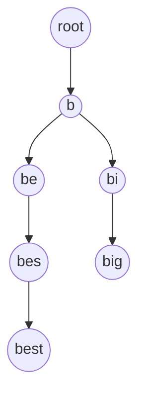
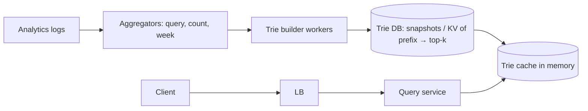

# 13 · Search Autocomplete (Typeahead)

**Difficulty:** 🟡 Medium &nbsp;|&nbsp; **Topics:** trie · top-k · caching

> [!TIP]
> **30-second answer**
> - Trie with top-k cached at each node gives O(prefix) lookups.
> - Rebuild offline from query logs; serve from memory with browser caching and sharding.

<b>Contents</b>

- [Requirements](#requirements)
- [Two services](#two-services)
- [Trie with cached top-k](#trie-with-cached-top-k)
- [Pipeline](#pipeline)
- [Query service optimizations](#query-service-optimizations)
- [Updates and filtering](#updates-and-filtering)
- [Common mistakes](#common-mistakes)
- [Practice questions](#practice-questions)

As the user types, show the top 5 most popular queries that start with the prefix.

## Requirements

- Results within ~100 ms per keystroke.
- Top-k by historical popularity; English, lowercase to start.
- 10M DAU × ~10 searches × ~20 keystrokes ≈ **~24,000 QPS**, peak ~48k.

## Two services

1. **Data gathering**: aggregate query logs into frequencies (offline, e.g. weekly or hourly).
2. **Query service**: serve the top-k for a prefix, very fast.

## Trie with cached top-k

- Each node = a prefix. Naively you'd traverse the subtree to find the top-k, which is too slow.
- Optimizations:
  - **Limit prefix length** (e.g. 50 chars).
  - **Cache the top-k queries at every node**, trading memory for O(prefix length) lookup.

*Each node stores something like `top: [best buy:35, bee:20, beer:10…]`.*

## Pipeline

## Query service optimizations

- AJAX requests, **browser caching** of results for a short time (prefix results rarely change).
- **Debounce** on the client.
- **Sharding** by first character(s), with a shard map to balance uneven letter frequencies.

## Updates and filtering

- Rebuild the trie periodically rather than updating it on every query.
- **Filter layer** to remove offensive or dangerous suggestions before serving.
- For trending/real-time: a separate streaming path that boosts recent queries.

## Common mistakes

- ❌ Updating the trie on every search in real time.
- ❌ Traversing the subtree for every keystroke.
- ❌ Forgetting to filter offensive suggestions.

## Practice questions

- Estimate trie memory if you cache top-5 at each node.
- How would you support multiple languages?
- How do you make breaking-news queries show up within minutes?
- How do you personalize suggestions per user?

---

[← Chat System](12-chat-system.md) &nbsp;·&nbsp; [🏠 All notes](../README.md) &nbsp;·&nbsp; [Video Streaming →](14-video-streaming.md)
