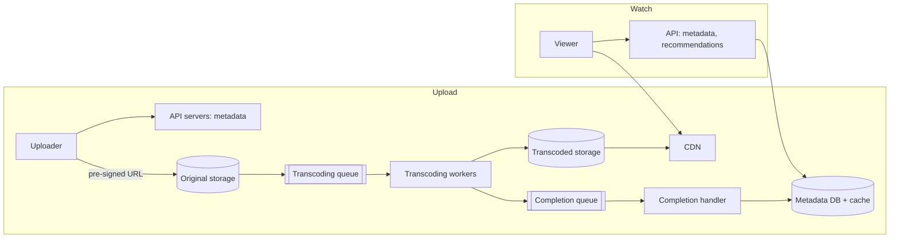

# 14 · Video Streaming Platform (YouTube-like)

Users upload videos; millions watch them on many devices and network speeds.

## Requirements

- Upload and watch videos; multiple resolutions; smooth playback worldwide.
- 5M DAU, ~5 videos watched per user per day, ~10% of users upload one video/day.
- Max video ~1 GB; average ~300 MB.

## Estimates

- Storage: 5M × 10% × 300 MB ≈ **150 TB/day**.
- CDN egress dominates cost: optimize what you serve from the CDN.

## Two flows

## Transcoding

- Convert to multiple **bitrates/resolutions** and codecs (H.264, VP9, AV1) for device compatibility.
- **Adaptive bitrate streaming** (HLS, MPEG-DASH): video split into small segments; the player switches quality based on bandwidth.
- Model the work as a **DAG** of tasks: split video → (video encode, audio encode, thumbnails, watermark) → merge.
- Split videos into **GOP-aligned chunks** to transcode in parallel and allow resumable uploads.

## Optimizations

- **Upload directly to object storage** with pre-signed URLs; upload in parallel chunks; use upload centers near users.
- **CDN only for popular videos**; serve the long tail from your own servers (or encode it on demand).
- Short or unpopular videos: fewer resolutions.
- Regional distribution: some content is only popular in some countries.

## Errors

- Recoverable (transcode task failed) → retry.
- Non-recoverable (corrupt file) → stop and tell the user.
- Every component replicated; metadata DB with replicas and failover.

## Security and rights

- Pre-signed upload URLs, DRM, AES encryption of segments, watermarking.

## Practice questions

- Why adaptive bitrate instead of one file per resolution?
- How do you make transcoding of a 2-hour video fast?
- What's the main cost driver, and how do you reduce it?
- How do you support live streaming instead of uploads?
