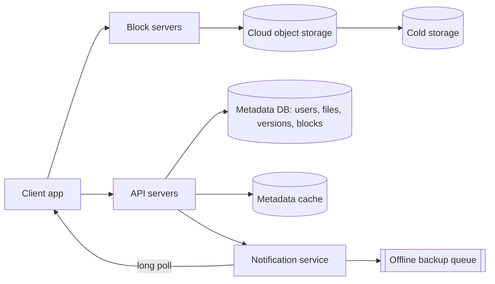

# 15 · Cloud File Storage and Sync (Drive/Dropbox-like)

**Difficulty:** 🔴 Hard &nbsp;|&nbsp; **Topics:** block sync · dedup · conflicts

> [!TIP]
> **30-second answer**
> - Split files into hashed blocks; sync only changed blocks (delta sync), dedup identical ones.
> - Strongly consistent metadata DB; notification service (long poll) tells devices to sync.

<b>Contents</b>

- [Requirements](#requirements)
- [Design](#design)
- [Block-level sync](#block-level-sync)
- [Upload flow](#upload-flow)
- [Metadata consistency](#metadata-consistency)
- [Conflicts](#conflicts)
- [Notifications](#notifications)
- [Storage efficiency](#storage-efficiency)
- [Common mistakes](#common-mistakes)
- [Practice questions](#practice-questions)

Upload, download, sync across devices, share, and keep version history.

## Requirements

- Files up to 10 GB; sync across devices; sharing; revision history.
- 10M DAU, 10 GB free per user.
- **Reliability is non-negotiable**: never lose data.

## Design

## Block-level sync

- Split files into **blocks** (e.g. up to 4 MB), each identified by its hash.
- **Delta sync**: only changed blocks are uploaded.
- **Compression** per block; **encryption** before storage.
- **Dedup**: identical blocks (same hash) are stored once across the account.

## Upload flow

1. Client asks the API to add file metadata, with status `pending`.
2. Client uploads blocks to block servers → object storage.
3. When complete, metadata is set to `uploaded`, and the notification service tells other devices.
4. Other devices fetch the new metadata and download only the blocks they lack.

## Metadata consistency

- Use a **relational DB** (ACID) for metadata; strong consistency matters here.
- Invalidate caches on write.

## Conflicts

- Two devices edit the same file offline: **first sync wins**; the second gets a conflict copy, and the user merges.

## Notifications

- **Long polling** is usually enough (changes are infrequent, one-way). WebSocket is fine too.

## Storage efficiency

- Keep a limited number of versions; weight recent versions.
- Move inactive data to **cold storage**.
- Cross-region replication for durability.

## Common mistakes

- ❌ Re-uploading whole files on every change.
- ❌ Eventual consistency for metadata.
- ❌ No conflict strategy for offline edits.

## Practice questions

- Why chunk files into blocks? What block size would you pick?
- How do you resume a failed 5 GB upload?
- What happens if the client goes offline mid-sync?
- How does sharing a folder with 1,000 users change the notification design?

---

[← Video Streaming](14-video-streaming.md) &nbsp;·&nbsp; [🏠 All notes](../README.md) &nbsp;·&nbsp; [Proximity Service →](16-proximity-service.md)
