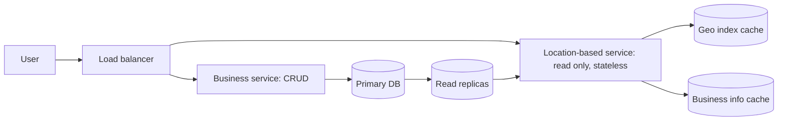

# 16 · Proximity Service (Yelp-like "nearby places")

**Difficulty:** 🟡 Medium &nbsp;|&nbsp; **Topics:** geohash · quadtree

> [!TIP]
> **30-second answer**
> - Geohash or quadtree index maps a location to nearby cells; search the cell plus its 8 neighbors.
> - The geo index is small enough to replicate in memory; business data is cached and read from replicas.

<details><summary><b>Contents</b></summary>

- [Requirements](#requirements)
- [API](#api)
- [Design](#design)
- [Geospatial indexing options](#geospatial-indexing-options)
- [Data](#data)
- [Common mistakes](#common-mistakes)
- [Practice questions](#practice-questions)

</details>

Given a user's location and a radius, return nearby businesses.

## Requirements

- Search businesses within a radius (0.5–20 km); view business details.
- Owners add/update businesses: changes can appear the **next day**.
- 100M DAU, 200M businesses; ~5 searches/user/day → **~5,000 QPS**.
- Low latency; read-heavy.

## API

```
GET /v1/search/nearby?lat=..&lng=..&radius=..   → list of businesses (paginated)
GET /v1/businesses/{id}
POST/PUT/DELETE /v1/businesses/{id}
```

## Design



## Geospatial indexing options

| Index | Idea | Notes |
|-------|------|-------|
| 2D lat/lng range scan | `WHERE lat BETWEEN … AND lng BETWEEN …` | Index on two columns intersects badly; slow |
| **Geohash** | Recursively split the world into a grid; encode cells as base32 strings. Shared prefix ≈ nearby | Simple, easy to shard; check the 8 neighbor cells for boundary issues |
| **Quadtree** | Split a cell into 4 until each leaf has ≤ N businesses | Adapts to density; in-memory tree built at startup |
| Google S2 / H3 | Hilbert curve / hexagonal cells | Great for geofencing, uneven regions |

### Geohash precision (approx.)

| Length | Cell size |
|--------|-----------|
| 4 | ~39 km × 19.5 km |
| 5 | ~4.9 km × 4.9 km |
| 6 | ~1.2 km × 0.6 km |

Pick the length from the radius; if too few results, shorten the prefix (expand the search).

## Data

- `geospatial_index(geohash, business_id)`: small (200M × ~20 bytes ≈ a few GB) → fits in memory; **replicate** rather than shard.
- Business table: shard by `business_id` if needed.
- Cache: `geohash → [business_ids]` and `business_id → details`.

## Common mistakes

- ❌ Range scans on raw lat/lng columns.
- ❌ Forgetting boundary cells.
- ❌ Sharding a small index that could just be replicated.

## Practice questions

- Why check the 8 neighboring geohash cells?
- Geohash vs quadtree: which do you choose and why?
- How do you rank results (distance vs rating vs open now)?
- How do you deploy across regions for latency and data residency?

---

[← Cloud File Storage](15-cloud-file-storage.md) &nbsp;·&nbsp; [🏠 All notes](../README.md) &nbsp;·&nbsp; [Nearby Friends →](17-nearby-friends.md)
