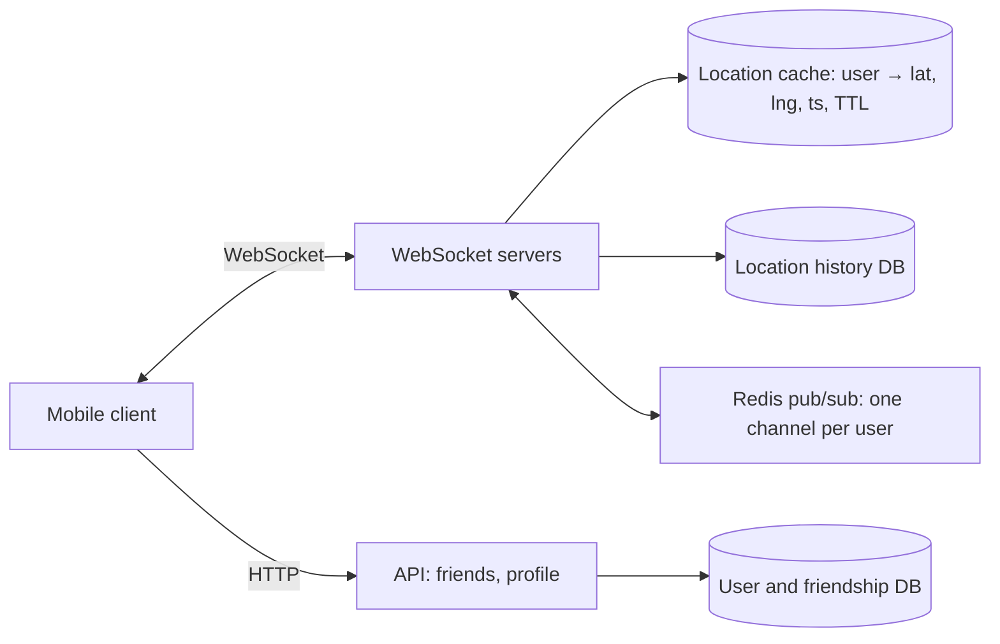

# 17 · Nearby Friends

**Difficulty:** 🔴 Hard &nbsp;|&nbsp; **Topics:** WebSocket · pub/sub · location cache

> [!TIP]
> **30-second answer**
> - Clients stream location over WebSockets every ~30 s; the server caches it with a TTL.
> - Each user has a pub/sub channel; friends' handlers subscribe and push updates only within the radius.

<b>Contents</b>

- [Requirements](#requirements)
- [Design](#design)
- [Update flow](#update-flow)
- [Scaling](#scaling)
- [Alternatives / extensions](#alternatives--extensions)
- [Common mistakes](#common-mistakes)
- [Practice questions](#practice-questions)

Show opted-in friends who are within ~5 miles, updated in near real time.

## Requirements

- Users see a list of nearby friends with distance and last-updated time.
- Locations refresh every ~30 s; stale after ~10 minutes of inactivity.
- 100M DAU, 10% concurrent → **10M concurrent users**, ~400 friends each.
- Location updates: 10M / 30 s ≈ **~334k updates/s**.

Unlike [16](16-proximity-service.md), the data here changes constantly, so this is a **real-time pub/sub** problem.

## Design

## Update flow

1. Client sends its location over the WebSocket.
2. Server writes it to the **location cache** (with TTL) and appends to **history** (wide-column DB).
3. Server **publishes** to the user's own pub/sub channel.
4. Every online friend's WebSocket handler is **subscribed** to that channel. It receives the update, computes the distance, and pushes it to the friend's client only if within the radius.

On connect: load friends, subscribe to each friend's channel, and fetch their cached locations for the initial list.

## Scaling

- **WebSocket servers** are stateful: drain connections before removing a node.
- **Redis pub/sub**: channels are cheap, but message fan-out is CPU-heavy: ~334k updates × ~40 online friends ≈ **~14M pushes/s**. Shard channels across many Redis servers with consistent hashing; use service discovery (etcd/ZooKeeper) to hold the hash ring.
- Location cache: shard by user ID.

## Alternatives / extensions

- Erlang/Elixir-style actor systems as an alternative to Redis pub/sub.
- "Nearby random people": pub/sub channel per **geohash cell** instead of per user.

## Common mistakes

- ❌ Querying the DB for friends' locations on every refresh.
- ❌ Underestimating pub/sub fan-out CPU.
- ❌ No TTL for inactive users.

## Practice questions

- Why not just query the DB for friends' locations every 30 s?
- How do you handle a user with 5,000 friends?
- What happens to subscriptions when a pub/sub server is added?
- How do you respect privacy (opt-out, approximate location)?

---

[← Proximity Service](16-proximity-service.md) &nbsp;·&nbsp; [🏠 All notes](../README.md) &nbsp;·&nbsp; [Maps and Navigation →](18-maps-navigation.md)
