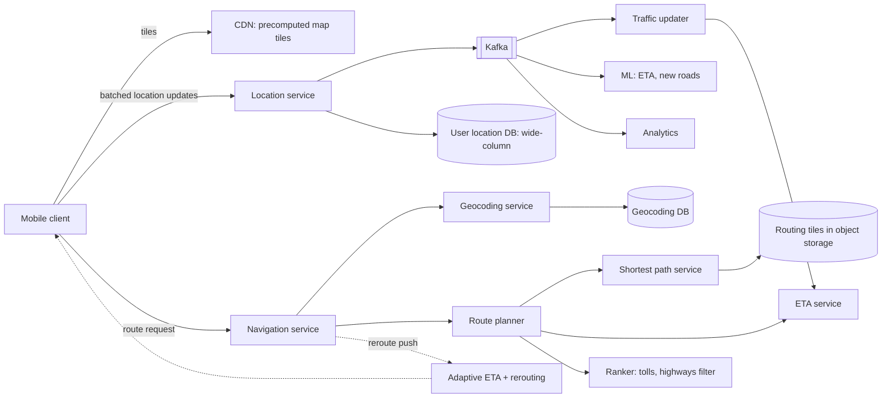

# 18 · Maps and Navigation (Google Maps-like)

**Difficulty:** 🔴 Hard &nbsp;|&nbsp; **Topics:** tiles · routing graph · ETA

> [!TIP]
> **30-second answer**
> - Precomputed map tiles per zoom level, served from a CDN.
> - Routing graph split into hierarchical routing tiles; shortest path (A*) plus an ML-based ETA.
> - Batched location updates feed traffic, ETA and rerouting.

<b>Contents</b>

- [Requirements](#requirements)
- [Key concepts](#key-concepts)
- [Design](#design)
- [Component notes](#component-notes)
- [Common mistakes](#common-mistakes)
- [Practice questions](#practice-questions)

Render maps, find routes, estimate travel time, and give turn-by-turn navigation.

## Requirements

- Location updates from users, navigation with ETA, map rendering on mobile.
- 1B DAU; ETA accurate and responsive to traffic; reroute on changes.
- Mobile-friendly: low data and battery usage.

## Key concepts

- **Map projection**: the sphere is drawn flat (Web Mercator).
- **Tiles**: the world is split into square image (or vector) tiles at each **zoom level**; zoom 0 = 1 tile, each level ×4.
- **Routing graph**: roads as nodes and edges. The whole world is too big for one graph, so split it into **routing tiles** (by geohash-like grid) at multiple levels of detail (local streets, arterials, highways).

## Design

## Component notes

- **Tiles**: precomputed, static, served by CDN. Vector tiles cut bandwidth and render smoothly.
- **Location updates**: buffer on the device and send batches (e.g. every 15 s) to save battery. Write-heavy → Cassandra-style DB.
- **Shortest path**: A* / Dijkstra variants over routing tiles loaded on demand; hierarchical tiles keep long routes tractable.
- **ETA**: combine historical speeds and live traffic with ML predictions.
- **Rerouting**: track active navigations by tile; when traffic changes in a tile, recompute ETA for affected users and push updates over a WebSocket.

## Common mistakes

- ❌ Loading the whole world graph into memory.
- ❌ Sending location every second and draining the battery.
- ❌ No plan for live rerouting.

## Practice questions

- How many tiles exist at zoom 21? Why precompute and CDN them?
- Why split the routing graph into tiles with different levels?
- How do you detect a traffic jam from user location data?
- How do you know which users to reroute when an accident happens?

---

[← Nearby Friends](17-nearby-friends.md) &nbsp;·&nbsp; [🏠 All notes](../README.md) &nbsp;·&nbsp; [Distributed Message Queue →](19-message-queue.md)
