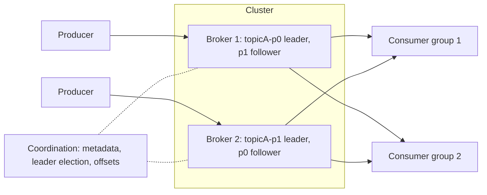

# 19 · Distributed Message Queue (Kafka-like)

A durable, high-throughput system for producers to publish messages and consumers to read them.

## Requirements

- Producers send to **topics**; consumers subscribe; messages can be re-read (retention ~2 weeks).
- Ordering within a partition; configurable delivery semantics.
- High throughput (GB/s) or low latency, tunable; durable and scalable.

## Core model

- **Topic** → split into **partitions** (an append-only log) spread across **brokers**.
- Each message has an **offset** within its partition.
- Message key → partition (`hash(key) % partitions`) keeps per-key ordering.
- **Consumer groups**: each partition is read by exactly one consumer in a group; different groups read independently.

## Storage

- **Write-ahead log** split into segments on disk; sequential I/O is fast, and the OS page cache does the caching.
- Batch messages on the producer and broker to boost throughput (at the cost of latency).

## Replication

- Each partition has a **leader** and **followers**; producers write to the leader.
- **ISR** (in-sync replicas): followers caught up within a lag threshold.
- Producer **acks**:
  - `acks=0` – fire and forget (fastest, may lose data)
  - `acks=1` – leader persisted
  - `acks=all` – all ISRs persisted (safest, slowest)

## Consumers

- **Pull** model: consumers control their rate and batching.
- Commit **offsets** to track progress. Commit after processing → at-least-once; before processing → at-most-once.
- **Rebalancing** when consumers join or leave, coordinated by a group coordinator.

## Delivery semantics

| Semantics | How |
|-----------|-----|
| At-most-once | acks=0, commit before processing |
| At-least-once | acks=all, commit after processing; consumers must be idempotent |
| Exactly-once | Idempotent producers + transactions, or dedup at the sink |

## Practice questions

- Why is a partition the unit of ordering and parallelism?
- What happens when a leader broker dies mid-write?
- How do you choose the number of partitions?
- How would you add delayed/scheduled messages?
