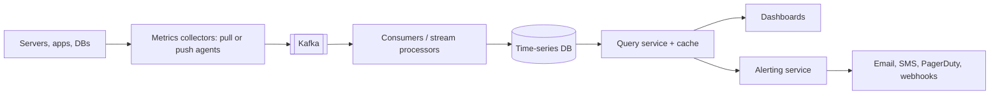

# 20 · Metrics Monitoring and Alerting

Collect infrastructure and app metrics (CPU, latency, error rates), visualize them, and alert on problems.

## Requirements

- 100M DAU-scale company; ~1,000 server pools × 100 machines × ~100 metrics → **~10M metrics**.
- Retention: raw for 7 days, 1-minute rollups for 30 days, 1-hour rollups for a year.
- Alerts via email, phone, PagerDuty, webhooks.
- Write-heavy; reads are bursty (dashboards, alert queries).

## Data model

A **time series** = metric name + labels/tags + a list of (timestamp, value).

```
http_requests_total{host="web-12", region="us-east", status="500"}  1700000000  42
```

**Cardinality** (unique label combinations) is the thing that explodes; avoid user IDs as labels.

## Design



## Pull vs push

| Pull (Prometheus-style) | Push (agent-based) |
|---|---|
| Collector scrapes `/metrics` endpoints found via service discovery | Agents on each host send metrics to collectors |
| Easy to tell if a target is down | Works behind firewalls and for short-lived jobs |
| Needs network reachability | Collector must handle bursts; aggregation can happen on the agent |

Both are fine; say which and why.

## Storage

- Use a purpose-built **TSDB** (InfluxDB, Prometheus TSDB, M3, etc.) over a general DB.
- **Delta-of-delta** and XOR-style compression shrink timestamps and values dramatically.
- **Downsampling** jobs roll raw data into coarser buckets; move old data to cold storage.
- Kafka in front decouples ingestion from storage outages.

## Alerting

- Rules in config files (YAML): `if p99_latency > 500ms for 5m → page`.
- Alert manager **dedupes, groups, silences**, and routes; retries delivery until acknowledged.
- Store alert state to avoid duplicate pages.

## Practice questions

- Why is cardinality the main scaling risk?
- How do you alert when the monitoring system itself is down?
- Explain how delta-of-delta encoding saves space.
- How long does a "last 30 days, p99 by region" dashboard query take, and how do you make it fast?
