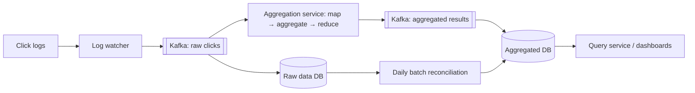

# 21 · Ad Click Event Aggregation

Count ad clicks in near real time for billing and dashboards. Correctness matters because money is involved.

## Requirements

- Clicks per ad in the last M minutes; top-N most-clicked ads per minute.
- Filter by country, device, etc.
- ~1B clicks/day → ~10k QPS avg, **~50k QPS peak**.
- Latency: a few minutes end to end for dashboards; **accurate** for billing.
- Handle late and duplicate events.

## Design (streaming + batch reconciliation)

Keeping the **raw data** allows recomputing if aggregation logic had a bug (a Kappa-style replay).

## Aggregation details

- **Map** by `ad_id % n` → **aggregate** counts in 1-minute windows → **reduce** to global top-N.
- **Event time vs processing time**: use event time for accuracy; handle late events with a **watermark** (extra wait).
- **Windows**: tumbling (fixed, non-overlapping) for per-minute counts; sliding for "last M minutes".

## Exactly-once

- Kafka consumer offsets and the aggregated output must be committed **atomically** (transactions), or dedupe at the sink by `(ad_id, window)`.
- Persist aggregation state (snapshots) to recover after a crash without double counting.

## Scaling and hotspots

- Partition Kafka by `ad_id`; add consumers up to the partition count.
- A hugely popular ad → allocate extra aggregation nodes for that key, or split it and merge the partial counts.

## Practice questions

- What happens to an event that arrives 5 minutes late?
- How do you prove the numbers billed to advertisers are correct?
- Tumbling vs sliding windows: which for which query?
- How do you filter by country without precomputing every combination?
