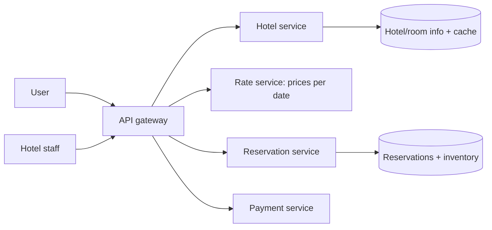

# 22 · Hotel Reservation System

**Difficulty:** 🟡 Medium &nbsp;|&nbsp; **Topics:** inventory · locking · idempotency

> [!TIP]
> **30-second answer**
> - Inventory row per (hotel, room type, date); booking checks reserved + requested ≤ capacity × 1.1.
> - Optimistic locking or a DB constraint prevents the last-room race; idempotency keys stop double-clicks.

<details><summary><b>Contents</b></summary>

- [Requirements](#requirements)
- [Services](#services)
- [Inventory model](#inventory-model)
- [Concurrency problems](#concurrency-problems)
- [Scaling](#scaling)
- [Common mistakes](#common-mistakes)
- [Practice questions](#practice-questions)

</details>

Search hotels, view rooms, and book a room type for a date range without double-booking.

## Requirements

- 5,000 hotels, 1M rooms; reserve a **room type** (not a specific room number).
- Payment at booking; cancellations allowed.
- Allow ~10% **overbooking** (configurable).
- Concurrency correctness: no more bookings than inventory allows.
- Reservation QPS is small (~3 TPS), but search/detail views are much higher.

## Services



A **relational DB** fits: read-heavy, ACID transactions for inventory.

## Inventory model

```
room_type_inventory(hotel_id, room_type_id, date, total_inventory, total_reserved)
```

One row per room type per date (pre-populated ~2 years ahead). Booking checks every date in the range:

```
total_reserved + requested <= total_inventory * 1.10
```

## Concurrency problems

1. **Same user double-clicks** → idempotency: generate a `reservation_id` on the client/form; unique constraint in the DB.
2. **Two users race for the last room**: both read "1 left" and both book. Options:

| Option | How | Trade-off |
|--------|-----|-----------|
| Pessimistic lock | `SELECT … FOR UPDATE` | Simple, but holds locks; deadlock risk |
| **Optimistic lock** | `version` column; update fails if version changed → retry | Great when contention is low (it is here) |
| DB constraint | `CHECK (total_reserved <= total_inventory * 1.1)` | Simple; same idea as optimistic |

## Scaling

- Shard by `hotel_id`; cache inventory in Redis for fast availability checks, but the **DB stays the source of truth**.
- If services own separate DBs (microservices), use the **saga pattern** or keep reservation and inventory in one DB to avoid 2PC.

## Common mistakes

- ❌ Booking specific room numbers.
- ❌ Treating the cache as the source of truth for inventory.
- ❌ Using 2PC across microservices without considering sagas.

## Practice questions

- Why reserve by room type instead of room number?
- Walk through optimistic locking for the last-room race.
- How does the cache stay consistent with the DB inventory?
- How do you handle a payment that fails after the room was held?

---

[← Ad Click Aggregation](21-ad-click-aggregation.md) &nbsp;·&nbsp; [🏠 All notes](../README.md) &nbsp;·&nbsp; [Email Service →](23-email-service.md)
