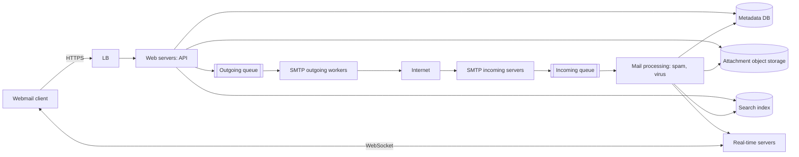

# 23 · Distributed Email Service (Gmail-like)

Send, receive, store, search, and sync email for a billion users.

## Requirements

- Send and receive email; folders/labels; read/unread; search; attachments.
- 1B users; ~100k sent emails/s at peak.
- Reliable (never lose mail), available, low-latency for the web client; spam/virus filtering.

## Traditional protocols

- **SMTP** – sending between mail servers.
- **IMAP/POP3** – fetching mail to clients (legacy).
- Modern web clients use HTTPS APIs plus WebSocket for real-time updates.
- **DNS MX records** say which server receives mail for a domain.

## Design

## Sending flow

1. Client sends via API → basic checks (size, rate limits).
2. Spam/virus check, then put on the outgoing queue.
3. SMTP workers deliver to the recipient's MX server; retry with backoff; bounces go to an error queue.
4. A copy goes into the sender's "Sent" folder.

## Metadata storage

- Access pattern: per-user, recent mail, by folder, unread filters.
- Wide-column/NoSQL keyed by **user_id** (partition) and `email_id` (time-sortable) for clustering.
- Denormalize for queries like "unread in Inbox": separate tables per query.
- Attachments in object storage (dedup identical attachments by hash).

## Search

- Per-user search, write-heavy (index on every received mail).
- Elasticsearch partitioned by `user_id`, or a custom LSM-based per-user index embedded with the data store.

## Deliverability

- SPF, DKIM, DMARC; dedicated IPs with gradual warm-up; feedback loops for complaints; separate pools for transactional vs bulk mail.

## Practice questions

- Why are emails stored per user instead of once per message?
- How do you keep search near real time on 1B mailboxes?
- How would you design labels (Gmail) vs folders?
- How do you stop your outgoing IPs from being blocklisted?
