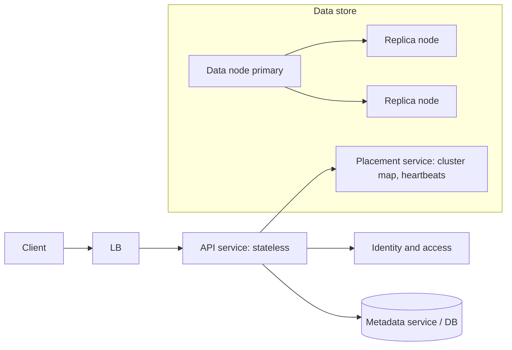

# 24 · Object Storage (S3-like)

Store and retrieve immutable objects (blobs) of any size through a simple HTTP API.

## Requirements

- Buckets and objects; `PUT`, `GET`, `DELETE`, list by prefix; versioning.
- Objects from KBs to TBs; 100 PB scale.
- **Durability 99.9999%+** (six nines or more), availability 99.99%.
- Cost-efficient storage.

## Key idea: separate metadata and data

- **Metadata** (bucket, name, version, object ID, size, ACL) is small and mutable → a metadata store.
- **Data** (the bytes) is large and immutable → a data store addressed by a UUID.

## Design

## Upload flow

1. Authenticate and authorize (IAM).
2. API sends the bytes to the data store → placement service chooses nodes → primary writes and replicates → returns an **object UUID**.
3. API writes metadata `(bucket, name) → UUID`.

## Data store internals

- Don't store each small object as a file: inode/metadata overhead is huge. **Append objects into large files** (e.g. a few GB each); keep an index `UUID → (file, offset, size)` in a local DB per node.
- Deletes are **marked**, then **compaction** rewrites files without deleted objects.
- **Placement service** keeps a cluster map (rack/zone aware) with Paxos/Raft for its own consistency.

## Durability

| Approach | Overhead | Notes |
|----------|----------|-------|
| 3× replication | 200% | Simple, fast reads |
| **Erasure coding** (e.g. 8 data + 4 parity) | 50% | Survives several failures; more CPU and slower reconstruction |

Also: spread across failure domains (racks, AZs) and **checksums** on every read and write to catch silent corruption.

## Other features

- **Multipart upload** for large objects: upload parts in parallel, then complete.
- **Versioning**: new UUID per version; metadata keeps the version list.
- **Listing** with prefix: metadata sharded by `(bucket, object name)` makes prefix listing a scatter-gather; optionally maintain a denormalized listing table.
- Garbage collection of orphaned data and old versions.

## Practice questions

- Why separate metadata from data?
- Erasure coding vs replication: when do you pick each?
- How do you detect and repair a corrupted chunk?
- How would you implement `LIST bucket?prefix=photos/2024/` efficiently?
