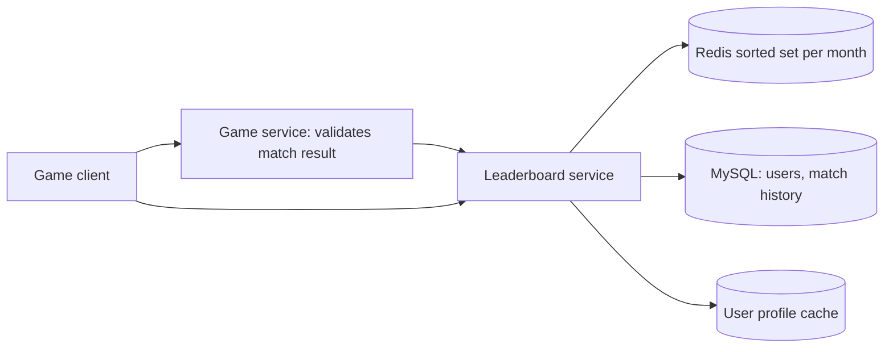

# 25 · Real-Time Gaming Leaderboard

**Difficulty:** 🟢 Easy &nbsp;|&nbsp; **Topics:** Redis sorted sets

> [!TIP]
> **30-second answer**
> - Redis sorted set per period: ZINCRBY to score, ZREVRANGE for top 10, ZREVRANK for a player's rank.
> - Score updates only come from the server; MySQL keeps history for rebuilds.

<b>Contents</b>

- [Requirements](#requirements)
- [Why not just a SQL table?](#why-not-just-a-sql-table)
- [Redis sorted sets](#redis-sorted-sets)
- [Design](#design)
- [Scaling to hundreds of millions of players](#scaling-to-hundreds-of-millions-of-players)
- [Common mistakes](#common-mistakes)
- [Practice questions](#practice-questions)

Track scores for a mobile game and show the top 10 plus each player's own rank in real time.

## Requirements

- A player wins a match → score increases.
- Show the **top 10** and the **player's rank** (± a few neighbors).
- Monthly leaderboard (resets each month).
- 5M DAU, 25M MAU; ~10 matches/player/day → ~500 score updates/s avg, ~2,500 peak.

## Why not just a SQL table?

`ORDER BY score DESC` over millions of rows on every request is too slow, and computing rank needs a scan. It works for small games; it doesn't scale for real-time ranking.

## Redis sorted sets

A sorted set keeps members ordered by score (skip list + hash), with O(log n) updates and rank lookups.

| Operation | Command |
|-----------|---------|
| Add points | `ZINCRBY leaderboard_2026_11 1 player_42` |
| Top 10 | `ZREVRANGE leaderboard_2026_11 0 9 WITHSCORES` |
| Player rank | `ZREVRANK leaderboard_2026_11 player_42` |
| Neighbors | `ZREVRANGE … rank-4 rank+4` |

## Design

- Score updates must come from the **server** (game service), never directly from clients, to prevent cheating.
- Persist match history to MySQL so Redis can be rebuilt after a failure; use Redis replicas and persistence.

## Scaling to hundreds of millions of players

| Option | How | Trade-off |
|--------|-----|-----------|
| Fixed partition by score range | Shard 1 = scores 0–100, … | Rank = local rank + count in higher shards; must move users between shards |
| Hash partition | Shard by user ID | Top-k needs scatter-gather across all shards; exact rank is costly |

Alternative: NoSQL (DynamoDB) with a write-sharded GSI on `(month#partition, score)`, accepting approximate ranks (percentiles) for low-ranked users.

## Common mistakes

- ❌ ORDER BY on a huge SQL table for every request.
- ❌ Letting clients submit scores directly.
- ❌ No answer for tie-breaking.

## Practice questions

- How do you break ties between equal scores?
- How do you reset the leaderboard monthly without downtime?
- How do you prevent fake scores?
- How would you compute a friends-only leaderboard?

---

[← Object Storage](24-object-storage.md) &nbsp;·&nbsp; [🏠 All notes](../README.md) &nbsp;·&nbsp; [Payment System →](26-payment-system.md)
