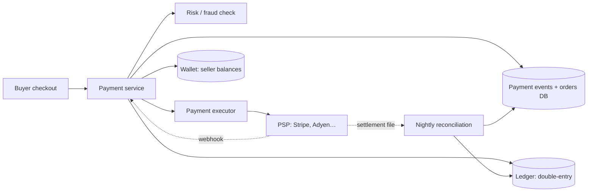

# 26 · Payment System

Backend for an e-commerce site to accept money from buyers (pay-in) and pay sellers (pay-out).

## Requirements

- Pay-in through external payment service providers (PSPs) like Stripe/Adyen; pay-out to sellers.
- Support refunds and chargebacks.
- ~1M transactions/day (~10 TPS): throughput is easy; **correctness and reliability** are the challenge.
- Never charge twice, never lose a payment, reconcile with PSP and bank reports.

## Pay-in flow

1. Checkout creates a **payment event** with one or more **payment orders** (one per seller).
2. Payment executor calls the PSP. Card details go into a **PSP-hosted payment page** so you never touch raw card numbers (keeps PCI scope small).
3. PSP notifies via **webhook** of success or failure.
4. Update the **wallet** (seller balance) and **ledger**.

## Ledger: double-entry accounting

Every transaction is recorded as equal debit and credit entries. The sum of all entries is always **zero**, which makes errors traceable.

| Account | Debit | Credit |
|---------|-------|--------|
| Buyer | $10 | |
| Seller | | $10 |

## Reliability

- **Idempotency key** (e.g. the order ID) on every request to the PSP and on internal APIs → retries never double-charge.
- **Retries** with exponential backoff; **dead-letter queue** for failures needing manual work.
- Track every payment as a **state machine** (`NOT_STARTED → EXECUTING → SUCCESS/FAILED`) persisted before and after external calls.
- **Exactly-once** = at-least-once (retry) + at-most-once (idempotency).
- **Reconciliation**: compare internal ledger to PSP settlement files daily; classify mismatches (auto-fix vs manual queue).
- Handle **slow PSP responses**: show "pending" and rely on webhooks plus polling.

## Consistency between services

- Keep ledger and wallet updates in one DB transaction when possible; otherwise use the **outbox pattern** or **sagas**.
- Read from the primary (or use consensus-replicated DBs) to avoid stale balances.

## Practice questions

- Show how an idempotency key prevents a double charge when the client times out and retries.
- Why double-entry bookkeeping?
- How do you handle a PSP webhook that never arrives?
- How do pay-outs differ from pay-ins in risk and timing?
