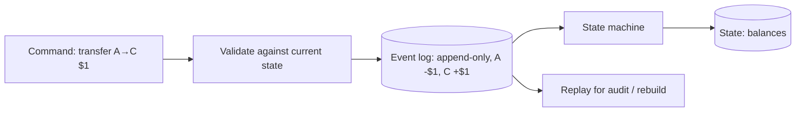

# 27 · Digital Wallet

Users hold balances and transfer money to each other instantly (think a payments app's internal balance).

## Requirements

- Balance transfers between wallets; ~**1M transfers/s** (TPS).
- Strict correctness: no money created or destroyed.
- Full **auditability**: reconstruct any balance at any point in time.
- High availability (99.99%).

## Estimate

A transfer = debit one account + credit another → **2M DB operations/s**. If one DB node handles ~1,000 TPS, you need **~2,000 nodes**: sharding plus distributed transactions are unavoidable.

## Approach 1: in-memory (Redis) shards

Fast, but no durability guarantees and no atomic cross-shard updates. Not acceptable for money.

## Approach 2: sharded relational DB + distributed transactions

| Technique | How | Trade-off |
|-----------|-----|-----------|
| **2PC** | Coordinator: prepare all → commit all | Locks held during the protocol; coordinator is a single point of failure |
| **Try-Confirm/Cancel (TC/C)** | Each step is a local transaction with a compensating action | No long locks; app-level complexity; out-of-order handling |
| **Saga** | Sequence of local transactions; compensate on failure | Good for long flows; intermediate states visible |

## Approach 3: event sourcing (strongest answer)

- **Commands** are validated; valid ones produce immutable **events**.
- **State** (balances) is derived by applying events in order, deterministically.
- Any historical balance can be reproduced by **replaying** events → audit for free.
- **CQRS**: write side appends events; read side builds query-friendly views.

### Making it fast and reliable

- Store events on **local disk** (append-only file, mmap) instead of a remote DB, plus local RocksDB/SQLite for state.
- **Snapshots** to avoid replaying from the beginning.
- Replicate the event log with **Raft** across nodes for fault tolerance.
- Partition accounts across many Raft groups; cross-partition transfers use **TC/C or saga** on top of event-sourced nodes.

## Practice questions

- Why is a single DB not enough at 1M TPS?
- Compare 2PC and TC/C failure modes.
- How do you prove to an auditor what Alice's balance was last March?
- What is a compensating transaction for a failed credit step?
