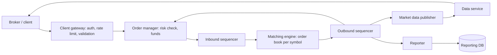

# 28 · Stock Exchange

Match buy and sell orders with very low, predictable latency and strict fairness.

## Requirements

- Place and cancel **limit orders**; get real-time market data (order book, candlestick charts).
- ~100 symbols, ~1B orders/day; trading hours ~6.5 h → ~43k orders/s avg, **~200k+ peak**.
- **Latency**: matching in microseconds/low milliseconds, and stable (low **p99 jitter**).
- Fairness, determinism, risk checks, and full audit.

## Three flows

1. **Trading (critical path)**: client → gateway → order manager (risk checks, wallet hold) → sequencer → **matching engine**.
2. **Market data**: execution results → market data publisher → order books and candlesticks → data service → clients.
3. **Reporting** (not latency critical): trades persisted for clearing, settlement, compliance.

## Order book and matching

- Per symbol: **buy side** (bids, descending price) and **sell side** (asks, ascending price).
- Each price level is a FIFO queue of orders: **price-time priority**.
- Data structure: map `price → doubly linked list of orders` + map `orderId → node`, so add, cancel and match are O(1).
- Matching is a **deterministic** function: the same input sequence always gives the same output.

## Sequencer

- Stamps every inbound order and outbound execution with a sequential ID.
- Guarantees ordering, enables replay and gap detection, and makes the system auditable.

## Low-latency techniques

- Put the critical-path components on **one server**, communicating through **shared memory (mmap) event stores** instead of the network.
- **Single-threaded** application loop pinned to a CPU core: no locks, no context switches.
- Avoid GC pauses (pre-allocation, off-heap memory) and disk I/O on the hot path.
- Replicate state by **replaying the event log** to a hot standby; use Raft across standbys for failover.

## Other topics

- **Market data fairness**: multicast so all subscribers receive data at the same moment; colocation services.
- **DDoS protection** at the gateway; read-only data cached and served via CDN for public quotes.

## Practice questions

- Why single-threaded rather than multi-threaded matching?
- How does the order book support O(1) cancel?
- How do you recover the matching engine after a crash without losing orders?
- How would you add market orders and stop orders?
